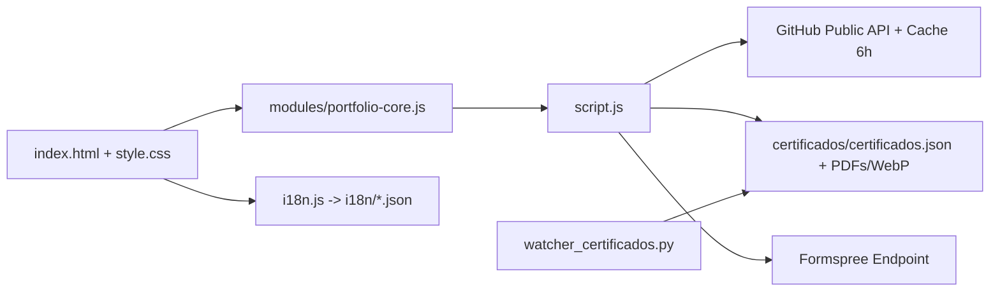

# Portfólio Técnico — Thaynan Passos (v3.0.0)

Portfólio estático hospedado no GitHub Pages (`https://thaynan-passos.github.io/`), desenvolvido com HTML5, CSS3 (**sistema visual Industrial**) e JavaScript modular puro (`ES6+`), sem dependências de build externas em runtime.

## Visão Geral

- **Identidade visual Industrial**: superfícies planas de alto contraste (`#0B0C0A` no modo escuro / `#F4F5F2` no modo claro), grade modular com filetes de `1px`, tipografia exclusivamente monoespaçada (`JetBrains Mono` com `tabular-nums`) e sinal único em verde de sistema (`#00E676` / `#007A3D`).
- **Console interativo no Hero**: suporta clique em comandos rápidos (`whoami`, `stack`, `projects`, `certs`, `experience`, `education`, `contact`, `cv`, `help`, `clear`) e digitação direta com histórico (`↑`/`↓`).
- **Conteúdo otimizado para ATS e recrutamento técnico**: dados reais de formação (ADS no IFPE), atuação no Sesc Pernambuco (UTD), 4+ anos em suporte e infraestrutura na UFPE, 15 certificados verificados e metadados `Schema.org` (`ProfilePage` + `Person`).
- **Internacionalização (i18n)**: suporte dinâmico para Português (`pt`), Inglês (`en`), Espanhol (`es`), Francês (`fr`) e Chinês (`zh`) com tradução segura via `textContent`.
- **Projetos dinâmicos do GitHub**: busca via API pública com cache em `localStorage` (TTL de 6 horas), timeout via `AbortController`, *Skeleton Loading*, busca com *debounce* e filtro por linguagem.
- **Gestão de certificados**: manifesto em `certificados/certificados.json` com filtros por área (`Dev & IA`, `Infra & Sec`, `Gestão & Ágil`), carrossel touch, grade e modal lightbox acessível; automação em Python (`watcher_certificados.py`) e GitHub Actions para geração de miniaturas WebP.

## Arquitetura do Projeto



## Estrutura de Diretórios

```text
Thaynan-passos.github.io/
├── .github/workflows/
│   ├── ci.yml                              # Quality Gate: lint, testes e build estático
│   └── generate-certificate-previews.yml   # Geração automática de miniaturas WebP
├── certificados/
│   ├── *.pdf                               # Certificados verificados (15 documentos)
│   ├── *.preview.webp                      # Miniaturas WebP dos PDFs
│   ├── certificados.json                   # Manifesto consumido pelo frontend
│   └── LEIA-ME.md
├── i18n/
│   ├── pt.json | en.json | es.json | fr.json | zh.json
├── imagens/
│   └── thaynan-foto.png
├── modules/
│   └── portfolio-core.js                   # Funções puras e sanitização (browser + Node)
├── scripts/
│   ├── validate.mjs                        # Validação estática e paridade de arquivos
│   └── build-check.mjs                     # Verificação de distribuição e orçamento
├── tests/
│   └── portfolio.test.mjs                  # Testes unitários nativos (node:test)
├── index.html
├── style.css
├── script.js
├── i18n.js
├── favicon.svg
├── watcher_certificados.py                 # CLI/GUI Python para novos certificados
├── package.json                            # Scripts de qualidade (Node >= 20, sem npm install)
├── CHANGELOG.md
└── THAYNANCurriculo.pdf
```

## Como Executar e Validar no Windows (PowerShell)

Não é necessário Docker nem instalação de pacotes `npm` externos. Requer apenas Node.js `>= 20`.

### 1. Executar as verificações de qualidade (Quality Gate)

```powershell
npm run lint
npm test
npm run build
```

### 2. Visualizar o site localmente

Para testar o carregamento de `i18n/*.json` e `certificados/certificados.json` via HTTP local no Windows:

```powershell
npx --yes serve .
```

*(Alternativamente, com Python instalado e PyMuPDF/watchdog, você pode processar novos PDFs via `python watcher_certificados.py --cli`.)*

---

**Versão atual:** `3.0.0` | **Última atualização:** `2026-11-19`
